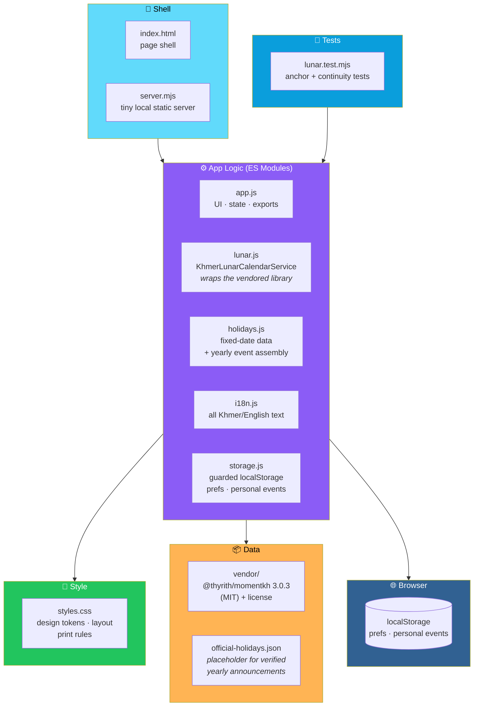

# 🇰🇭 ប្រតិទិនខ្មែរ · Khmer Calendar

<div align="center">


**Gregorian and Khmer lunar dates, together.**

*Cambodian holidays · Buddhist observances · Festivals · Personal events*

[🚀 Quick Start](#-quick-start) • [✨ Features](#-features) • [🗓️ Date Sources](#-where-the-dates-come-from-and-their-limits) • [🏗️ Architecture](#️-architecture) • [🔐 Security](#-security-notes)

</div>

---

## 📖 Overview

**Khmer Calendar** is a **bilingual (Khmer / English) calendar** that shows **Gregorian and Khmer lunar dates together**, with Cambodian holidays, Buddhist observances, festivals, and personal events.

### Core Idea

> **Plain HTML + ES modules.**
>
> **No build step, no framework, no database.** Upload the folder to any static host and it works.

---

## 🚀 Quick Start

```bash
npm start        # http://localhost:5173   (needs Node 18+)
npm test         # lunar-calendar anchor tests
```

### Any Static Host Works

- **Netlify**
- **GitHub Pages**
- **Cloudflare Pages**
- **nginx**
- Anything else serving static files

> ⚠️ **Open it through a server, not `file://` — it uses ES modules.**

---

## ✨ Features

<div align="center">

| 📅 Month Grid | 🗓️ Today & Upcoming |
|:---:|:---:|
| Gregorian + Khmer lunar date per day *(`កើត`/`រោច`, month, full moon)* · jump to any month, year, or date | **Today card** · **30-day upcoming list** · category legend *(icon + text, **never colour alone**)* |
| **🌐 Bilingual** | **📝 Personal Events** |
| Khmer ⇄ English switch for the whole UI — remembered between visits | Add · edit · delete · multi-day · search · filter — **stored in this browser only** *(not synced)* |
| **🔍 Search & Filter** | **📤 Export** |
| By name *(Khmer/English)*, date, or lunar month · category filter | Personal events as **CSV** · calendar as **`.ics`** *(UTF-8, **Khmer-safe**)* · **print-friendly page** |
| **⚙️ Settings** | |
| Lunar dates on/off · international days on/off · **light / dark / auto theme** | |

</div>

### 📅 The Month Grid

- **Gregorian date** and **Khmer lunar date** for every day
- Lunar details include:
  - **កើត** / **រោច** *(waxing / waning)*
  - **Month**
  - **Full moon**
- **Jump to any month, year, or date**

### 🗓️ Today & Upcoming

- **Today card**
- **30-day upcoming list**
- **Category legend** — icon + text, **never colour alone**

### 🌐 Bilingual

- **Khmer ⇄ English** switch for the entire UI
- **Remembered between visits**

### 📝 Personal Events

- **Add, edit, delete**
- **Multi-day** support
- **Search** and **filter**

> 🔒 **Stored in this browser only — not synced.**

### 🔍 Search & Filter

- **By name** — Khmer or English
- **By date**
- **By lunar month**
- **Category filter**

### 📤 Export

| Format | Details |
|--------|---------|
| **CSV** | Personal events |
| **`.ics`** | The calendar — **UTF-8, Khmer-safe** |
| **Print** | A print-friendly page |

### ⚙️ Settings

- **Lunar dates** on / off
- **International days** on / off
- **Theme** — light / dark / auto

---

## 🗓️ Where the Dates Come From (and Their Limits)

### 🌙 Lunar Dates

**Library:** [`@thyrith/momentkh`](https://github.com/ThyrithSor/momentkh) — a **community implementation of the Khmer calendar rules**.

> ⚠️ **Dates are NOT derived from astronomical moon phases.**

### 🧮 Lunar Observances

These are **computed** from the rules *(e.g. 15 waxing of Pisakh)* and labelled **"computed"**:

- **Meak Bochea**
- **Visak Bochea**
- **Pchum Ben**
- **Water Festival**
- **Khmer New Year**

**Multi-day observances:**

| Observance | Duration |
|-----------|:--------:|
| **Pchum Ben** | **3 days** |
| **Water Festival** | **3 days** |
| **Khmer New Year** | **3 days from the new-year day** |

### 📌 Fixed-Date Holidays

**Examples:** 1 Jan, 7 Jan, 1 May, 9 Nov — these use their **usual Gregorian date** and are labelled **"fixed"**.

### ⚠️ Official Days Off Are NOT Bundled

> **The government announces them each year and they can differ from computed dates** *(extra days, bridge days)*.
>
> **Confirm against the official announcement before relying on any date.**

### ❌ Not Included

Not included because reliable rules could not be verified:

- **Royal Ploughing Ceremony**
- **Asalha Puja**
- **Other weekly Buddhist holy days**

### ✅ Verified So Far

> **See `tests/lunar.test.mjs`.**

<div align="center">

| Observance | Verified Dates |
|-----------|---------------|
| **Visak Bochea** | 2024-05-22 · 2025-05-11 |
| **Meak Bochea** | 2025-02-12 |
| **Pchum Ben** | 2024 (1–3 Oct) · 2025 (21–23 Sep) |
| **Water Festival** | 2024 (14–16 Nov) |
| **Khmer New Year** | 2026 (14 Apr) |
| **Day-sequence continuity** | 2024–2026 |

</div>

### 🧭 Please Cross-Check Leap-Month Years

> **The library and other Khmer calendars can disagree there.**
>
> *For example, Meak Bochea 2026 could not be confirmed.*
>
> **Cross-check against an official Cambodian calendar and add more anchors to the test file.**

---

## 🏗️ Architecture

### System Overview



### 📂 Structure

```
khmer-calendar/
├── index.html                    page shell
├── server.mjs                    tiny local static server
│
├── src/
│   ├── js/
│   │   ├── app.js                UI + state + exports
│   │   ├── lunar.js              KhmerLunarCalendarService
│   │   │                         (wraps the vendored library)
│   │   ├── holidays.js           fixed-date holiday data
│   │   │                         + yearly event assembly
│   │   ├── i18n.js               all Khmer/English text
│   │   └── storage.js            guarded localStorage
│   │                             (prefs, personal events)
│   │
│   ├── css/
│   │   └── styles.css            design tokens · layout · print rules
│   │
│   └── vendor/                   @thyrith/momentkh 3.0.3 (MIT)
│                                 + its license
│
├── data/
│   └── official-holidays.json    placeholder for verified yearly announcements
│
└── tests/
    └── lunar.test.mjs            anchor + continuity tests
```

### Design Principles

<div align="center">

| Principle | Implementation |
|-----------|---------------|
| **📦 Zero infrastructure** | Plain HTML + ES modules — no build step, no framework, no database |
| **🌐 Bilingual by design** | Every string lives in `i18n.js` — the entire UI switches with one preference |
| **🧮 Dates are labelled honestly** | *"Computed"* vs *"fixed"* — the app tells you where a date came from |
| **⚠️ Official days off are not bundled** | The government announces them each year — the app doesn't guess |
| **🧪 Anchors are tested** | Real dates are verified in `tests/lunar.test.mjs` — anyone can add more |
| **🔒 Privacy by default** | Personal events live only in this browser — no backend, no accounts, no sync |
| **♿ Colour is never the only signal** | Categories use **icon + text** in the legend |
| **🖨️ Print is a first-class output** | Print rules live in `styles.css` — not bolted on later |

</div>

---

## 📝 Updating Holiday Data

### Step 1 — Get the Official Announcement

From the **Royal Government / Ministry of Labour**.

### Step 2 — Record Each Day

In **`data/official-holidays.json`**, record:

- **Name** — Khmer and English
- **Dates**
- **Source URL**

**Keep previous years untouched.**

### Step 3 — Wire It In

> 💡 **Wiring this file into the UI** *(to override "computed" / "fixed" labels with "official")* **is the first roadmap item.**

---

## 🔐 Security Notes

<div align="center">

| Protection | Implementation |
|-----------|---------------|
| **XSS** | All user text is **HTML-escaped** before rendering |
| **CSV injection** | Cells starting with `=`, `+`, `-`, or `@` are **neutralised** |
| **Storage safety** | Storage access is **wrapped in try/catch** |
| **No backend** | **No accounts, no secrets, no SQL** |

</div>

---

## 🧪 Tests

```bash
npm test
```

### What's Covered

- **Lunar-calendar anchor tests** — verified dates for Visak Bochea, Meak Bochea, Pchum Ben, Water Festival, and Khmer New Year
- **Day-sequence continuity** for 2024–2026

> 💡 **Anyone can add more anchors** — the test file is the contract.

---

## ⚠️ Known Limitations

<div align="center">

| Limitation | Details |
|-----------|---------|
| **Lunar dates come from a community library** | **Not** derived from astronomical moon phases |
| **Official days off not bundled** | The government announces them each year — they can differ from computed dates |
| **Leap-month years can disagree** | The library and other Khmer calendars may differ — cross-check against an official Cambodian calendar |
| **Some observances not included** | Royal Ploughing Ceremony, Asalha Puja, and other weekly Buddhist holy days |
| **Personal events are not synced** | Stored in this browser only |

</div>

---

## 🗺️ Roadmap

### ✅ Current

- [x] Month grid with Gregorian + Khmer lunar dates
- [x] Jump to any month, year, or date
- [x] Today card
- [x] 30-day upcoming list
- [x] Category legend with icon + text
- [x] Khmer ⇄ English UI switch, remembered between visits
- [x] Personal events — add, edit, delete, multi-day, search, filter
- [x] Browser-local storage for personal events
- [x] Search by name (Khmer/English), date, or lunar month
- [x] Category filter
- [x] CSV export for personal events
- [x] `.ics` export — UTF-8, Khmer-safe
- [x] Print-friendly page
- [x] Settings — lunar dates on/off, international days on/off, light/dark/auto theme
- [x] HTML escaping on all user text
- [x] CSV injection neutralisation
- [x] Guarded storage access
- [x] Lunar anchor tests with real verified dates
- [x] Day-sequence continuity tests for 2024–2026
- [x] Placeholder `official-holidays.json` for verified yearly announcements

### 🔜 Future Ideas

- [ ] **Official-holiday loading** — override "computed" / "fixed" labels with "official"
- [ ] **Verified badges** — mark dates confirmed against official sources
- [ ] **Week and agenda views**
- [ ] **PDF export**
- [ ] **Reminders and recurrence**
- [ ] **Favourites and countdown cards**
- [ ] **Backend with accounts** and an admin role for shared data
- [ ] **More anchors** for leap-month years
- [ ] **Additional observances** — Royal Ploughing Ceremony, Asalha Puja
- [ ] **Khmer numerals option** in the UI

---

## 🤝 Contributing

Contributions are welcome. Please:

1. Fork the repository
2. **Keep it build-free** — no bundlers, no frameworks, ES modules only
3. **Add anchors, not assumptions** — every verified date goes in `tests/lunar.test.mjs`
4. **Label honestly** — *"computed"* vs *"fixed"* vs *(future)* *"official"*
5. **Never bundle official days off** — they change annually and require a source
6. **Keep personal data local** — no telemetry, no sync without consent
7. **Escape all user text** and neutralise CSV cells
8. Submit a Pull Request

### Guidelines

- **Never guess an official date** — cite a source URL
- **Never claim a date is verified** without an anchor test
- **Never remove a limitation** without actually fixing it
- **Never break existing personal events** without a migration path
- **Never add a required runtime dependency** — the vendored library is the only one

---

## 📜 License

**MIT** for this project.

**Vendored library:** MIT — see **`src/vendor/MOMENTKH-LICENSE`**.

---

## 🙏 Acknowledgments

- **`@thyrith/momentkh`** — for a community implementation of the Khmer calendar rules
- **Every Cambodian calendar keeper** who's ever cross-checked a lunar date by hand — this is for you

---

<div align="center">

### 🇰🇭 GREGORIAN AND LUNAR, TOGETHER.

**Bilingual. Build-free. Honest about what it knows.**

**No build step, no framework, no database.**

<br>

> 🗓️ **Computed dates are labelled. Fixed dates are labelled. Official days off are yours to verify.**

<br>

⭐ If this calendar helped you, consider giving it a star.

<br>

[⬆ Back to Top](#-ប្រតិទិនខ្មែរ--khmer-calendar)

</div>
